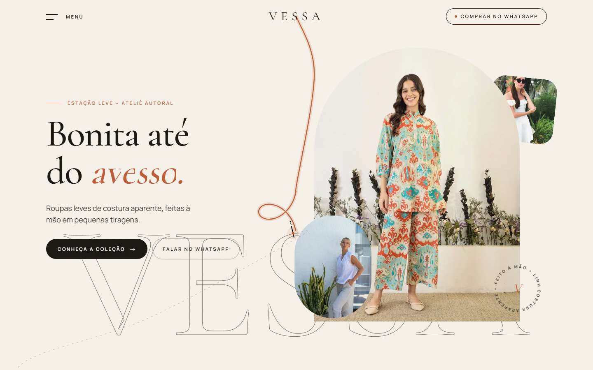

# VESSA

**Landing page de moda** · Next.js · TypeScript · Tailwind CSS

[](https://vessa-atelie.vercel.app)
[](https://nextjs.org)
[](https://www.typescriptlang.org)
[](https://tailwindcss.com)
[](https://www.framer.com/motion/)
[](LICENSE)

Landing page para a **VESSA**, uma marca de moda **fictícia** criada para este projeto. O conceito é "bonita até do avesso": roupas leves de costura aparente, feitas à mão em pequenas tiragens. A página inteira é costurada por um fio animado, que nasce no logo, atravessa cada seção com curvas e nós e termina amarrado no footer.

🔗 **Demo:** [vessa-atelie.vercel.app](https://vessa-atelie.vercel.app)



> Projeto de portfólio. A VESSA não existe: nome, textos, produtos e locais foram inventados, e as fotos são ilustrativas do [Unsplash](https://unsplash.com/license).

## Funcionalidades

- **O fio**: um SVG curvo e orgânico que nasce no logo, atravessa a página inteira com nós e ondulações, é "costurado" conforme o scroll (alinhavo pontilhado à frente, fio sólido atrás) e leva uma agulha na ponta
- Menu hambúrguer em tela cheia com revelação circular, categorias e preview de foto no hover
- Hero com wordmark gigante e colagem de fotos com parallax pelo mouse
- Manifesto fixado no scroll, com as palavras acendendo uma a uma
- As cenas de scroll tocam uma única vez: as revelações não voltam em reverse, e as seções fixadas viram seções normais depois da primeira passagem
- Coleção em galeria horizontal fixada no scroll na primeira passagem, que depois vira carrossel livre (arrastar, deslizar, trackpad e setas): cards em arco com etiqueta de roupa pendurada que balança com o movimento
- Produto destaque com hotspots na foto e seletor de tamanho que vai direto para a mensagem do WhatsApp
- "Onde encontrar" em painéis expansíveis com foto de cada ponto, alternando sozinhos
- Revenda com spotlight que segue o mouse e formulário em 3 etapas que monta a mensagem no WhatsApp
- Comunidade em carrossel contínuo de fotos e CTA final com imagem que se expande no scroll
- Footer com o fio fechando a narrativa e botão "voltar ao topo" giratório
- Scroll suave, textura de grão e desempenho medido (geometria do fio calculada em JS, sem consultas ao DOM durante o scroll)
- Eventos de analytics (GA4 / Meta Pixel) nos cliques de WhatsApp e no envio do formulário de revenda
- SEO completo: metadata, OpenGraph, `sitemap.xml`, `robots.txt`, JSON-LD (`ClothingStore`)

Todo o conteúdo editável (produtos, locais, links do menu, fotos) fica em `src/lib/content.ts`.

## Stack

- [Next.js 16](https://nextjs.org) (App Router) + React 19 + TypeScript
- Tailwind CSS v4
- [Framer Motion](https://www.framer.com/motion/) para todas as animações e o fio
- [Lenis](https://lenis.darkroom.engineering/) para o scroll suave

Projeto **frontend-only**: não há backend nem banco de dados. O formulário de revenda e os CTAs de produto convertem direto em um link do WhatsApp (`wa.me`) com mensagem pré-preenchida.

## Rodando localmente

```bash
git clone https://github.com/joaobatis1a/vessa.git
cd vessa
npm install
cp .env.example .env.local
npm run dev
```

Abra [http://localhost:3000](http://localhost:3000). Sem `.env.local`, o site roda com os valores de exemplo.

### Variáveis de ambiente

| Variável | Para quê |
|---|---|
| `NEXT_PUBLIC_SITE_URL` | URL de produção (metadata, sitemap, robots, OpenGraph) |
| `NEXT_PUBLIC_WHATSAPP_NUMBER` | Número no formato `55DDDNUMERO`, sem símbolos |
| `NEXT_PUBLIC_INSTAGRAM_URL` | Link do perfil no Instagram |
| `NEXT_PUBLIC_GA_ID` | ID do Google Analytics 4 (`G-XXXXXXX`); se vazio, o script não carrega |
| `NEXT_PUBLIC_META_PIXEL_ID` | ID do Meta Pixel; se vazio, o script não carrega |

## Deploy

```bash
npm i -g vercel
vercel --prod
```

## Licença

Código distribuído sob a licença MIT. Veja [LICENSE](LICENSE). As fotos seguem a [licença do Unsplash](https://unsplash.com/license).
